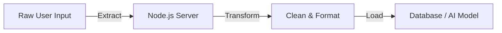
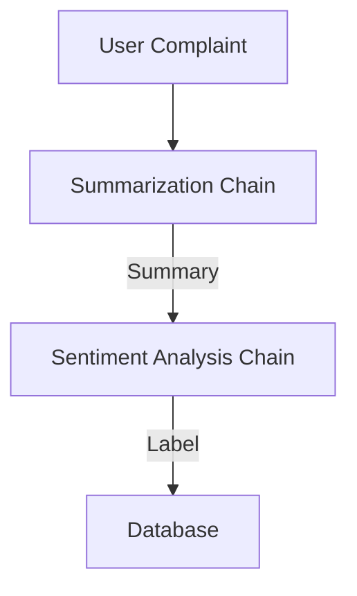

# Module: DATA PIPELINES FOR AI APPLICATIONS

**Session Time:** 120 minutes

---

## Table of Contents

1. Introduction to Data Pipelines (ETL)
2. Data Collection Strategies for AI
3. Preprocessing: Cleaning Data for Models
4. Orchestration with LangChain
5. Lab: Building a Data Ingestion Pipeline
6. Wrap-Up and Reflection
7. Resources

---

## Module Overview

Learners design basic data collection and preprocessing workflows to support AI personalization and analytics. While previous modules focused on getting data *out* of an AI, this module focuses on getting data *in*—preparing user inputs and interactions to improve models or power personalization features.

---

## Learning Objectives

By the end of this module, participants will be able to:

1. 
**Design and implement simple data pipelines** to feed and store AI-related data for web applications.


2. **Apply preprocessing techniques** such as sanitization, tokenization, and formatting to ensure data quality for AI models.
3. **Utilize LangChain** to create sequential chains that automate the flow of data from user input to storage or further processing.

---

## Session Breakdown

| Segment | Topic | Duration (minutes) |
| --- | --- | --- |
| 1 | Introduction to Data Pipelines (ETL) | 20 |
| 2 | Data Collection Strategies for AI | 20 |
| 3 | Preprocessing: Cleaning Data for Models | 25 |
| 4 | Orchestration with LangChain | 25 |
| 5 | Lab: Building a Data Ingestion Pipeline | 30 |

---

## 1. Introduction to Data Pipelines (ETL)

A **Data Pipeline** is a set of automated processes that move data from one place to another, transforming it along the way. In AI, this is critical because raw data is often messy and unusable by models.

### The ETL Model

* **Extract:** Gathering data from sources (User forms, API logs, databases).
* **Transform:** Cleaning and formatting the data (Removing HTML tags, anonymizing names, vectorizing text).
* **Load:** Storing the clean data in a destination (Vector Database, Data Warehouse).



---

## 2. Data Collection Strategies for AI

To build personalized AI experiences, you need to collect the right signals without violating user privacy.

### Types of AI-Ready Data

* **Explicit Feedback:** Thumbs up/down on an AI response. This is gold for "Fine-Tuning."
* **Implicit Signals:** How long a user spends reading a generated article (Dwell time).
* **Contextual Data:** The user's location or previous purchase history, which helps the AI generate relevant answers.

### Example: The Feedback Loop

If you are building a chatbot, every interaction is a data point.

1. **User:** "Show me shoes."
2. **AI:** Shows boots.
3. **User:** *Clicks "Next".* (Implicit signal: "I don't want boots").
4. **Pipeline:** Capture this event  Tag "Boots" as negative for this session.

---

## 3. Preprocessing: Cleaning Data for Models

"Garbage In, Garbage Out." If you feed an AI messy data, you get bad predictions. Preprocessing is the "Transform" step where we clean the data.

### Common Preprocessing Steps

1. **Sanitization:** Removing PII (Personally Identifiable Information) like emails or phone numbers to ensure privacy.
2. **Normalization:** Converting text to lowercase or removing special characters to standardize inputs.
3. **Chunking:** Splitting long documents into smaller pieces so they fit within an AI model's "Context Window."

### Code Example: Simple Sanitization

```javascript
function preprocessInput(text) {
    // Remove email addresses for privacy
    const sanitized = text.replace(/[\w-\.]+@([\w-]+\.)+[\w-]{2,4}/g, "[REDACTED]");
    // Trim whitespace and lowercase
    return sanitized.trim().toLowerCase();
}

```

---

## 4. Orchestration with LangChain

**LangChain** is a powerful framework designed to build pipelines specifically for LLMs. It allows you to chain multiple operations together—like reading a file, cleaning it, and then sending it to an AI—using a standardized syntax.

### Why LangChain?

It abstracts the complexity of connecting different data sources (PDFs, Databases, APIs) to AI models. It treats these connections as "Chains."

### Example: A Sequential Chain

Imagine a pipeline that takes a user's complaint, summarizes it, and then detects the sentiment.



**Conceptual LangChain Code:**

```javascript
import { OpenAI } from "langchain/llms/openai";
import { PromptTemplate } from "langchain/prompts";
import { LLMChain } from "langchain/chains";

// 1. Define the model
const model = new OpenAI({ temperature: 0 });

// 2. Define the prompt template (The Transformation)
const template = "Summarize this text in one sentence: {inputText}";
const prompt = new PromptTemplate({ template, inputVariables: ["inputText"] });

// 3. Create the Chain (The Pipeline)
const chain = new LLMChain({ llm: model, prompt: prompt });

// 4. Run the Pipeline
const res = await chain.call({ inputText: "Long user complaint..." });

```

---

## 5. Lab: Building a Data Ingestion Pipeline

**Objective:** Build a small data ingestion pipeline to store user input for model improvement.

### Scenario

You are building a "Customer Feedback" system. You need to collect raw feedback, strip out sensitive emails, summarize the feedback using AI, and save the clean entry to a file (simulating a database).

### Step 1: Setup

* Initialize a Node.js project.
* Install LangChain and OpenAI: `npm install langchain openai dotenv`.

### Step 2: Create the Preprocessor

Write a function `cleanData(rawText)` that removes email addresses using regex (as shown in section 3).

### Step 3: Create the LangChain Flow

* Set up an `LLMChain` that takes the *cleaned* text and asks the AI to "Categorize this feedback as: Bug, Feature Request, or Praise."

### Step 4: The "Load" Step

* Use the `fs` (File System) module in Node.js to append the final JSON object (Original Text, Category, Timestamp) to a `data.json` file.

### Step 5: Test

Run your script with different inputs containing fake emails and see if they are redacted in the final file.

---

## 6. Wrap-Up and Reflection

**Reflection Questions:**

1. Why is it important to scrub PII (emails/names) *before* sending data to an external AI provider like OpenAI?
2. How does LangChain help manage complex pipelines compared to writing raw nested functions?

---

## 7. Resources

* [LangChain JS Documentation](https://www.google.com/search?q=https://js.langchain.com/docs/)
* [Node.js File System API](https://nodejs.org/api/fs.html)
* [The ETL Data Pipeline Explained](https://www.ibm.com/topics/etl)